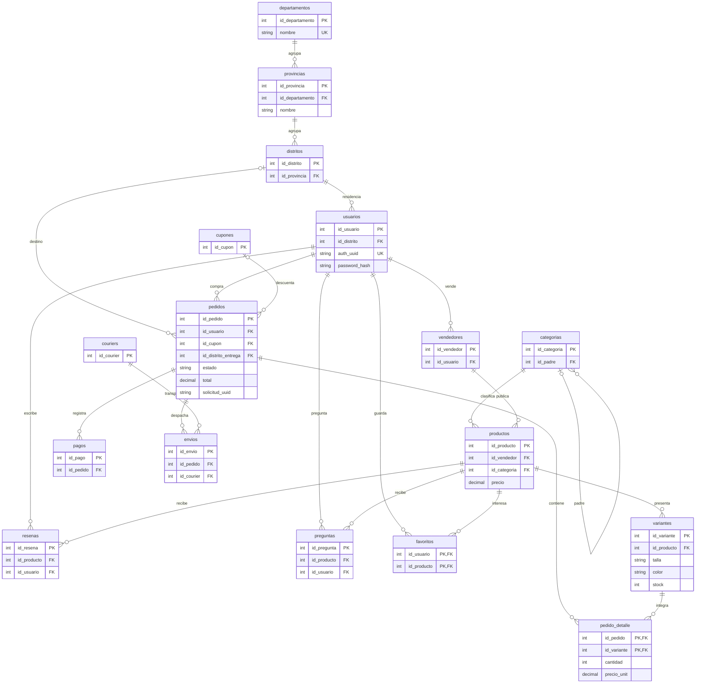

# Modelo entidad-relación

17 tablas y 22 FK, contando la autorrelación de categorías.
Tipos, restricciones y columnas completas en [01_esquema.sql](../sql/01_esquema.sql).

`pedido_detalle` resuelve pedidos–variantes; `favoritos`, usuarios–productos.
Cada producto pertenece a un vendedor. La aplicación consolida un envío por
pedido multivendedor; el esquema admite múltiples pagos/envíos para conservar
el histórico original.

Las extensiones permiten autenticación, descripción/foto/origen, estrategia de
courier y solicitudes idempotentes. El destino web usa una FK a distritos.
Las vistas reconstruyen geografía e importes; el histórico solo permite inferir
distrito desde el usuario. Ver [justificación de 3FN](NORMALIZACION_3FN.md).
