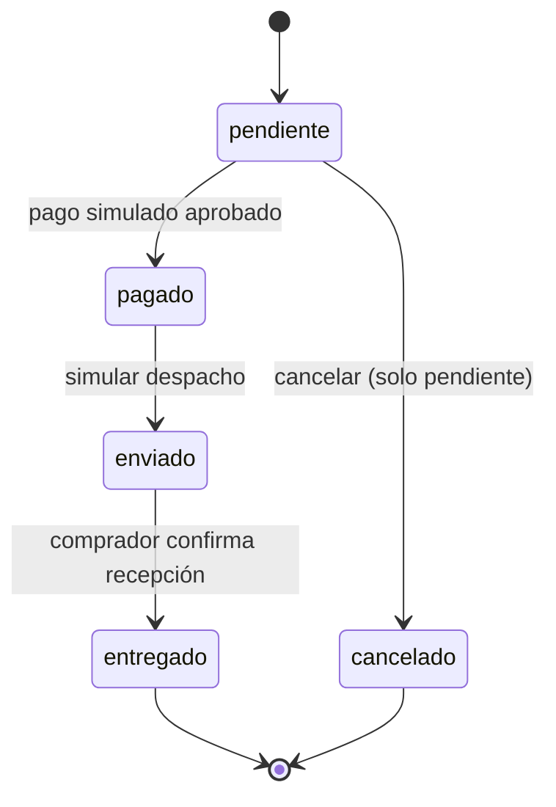

# Patrones en el flujo real

Implementación: `Pagina Web/backend/academic/patterns.py`.
Integración: `commerce.py:quote_cart`, `checkout` y `advance`.

## Builder

`OrderBuilder` reúne variantes, cantidades, cupón y envío. Agrupa variantes
repetidas y devuelve un `OrderDraft` inmutable. La tarifa usa la cantidad final,
aunque se configure la estrategia antes de agregar los ítems.

```python
draft = (OrderBuilder()
    .add_item(101, 2, '25.00')
    .add_item(102, 1, '25.00')
    .with_coupon('GRUPO', 10)
    .shipping(StandardShipping(), '12.00', 'Lima')
    .build())
```

Subtotal S/75,00; volumen S/2,25; cupón S/7,28; envío S/12,00;
total **S/77,47**. Dinero con `Decimal` y redondeo de mitad hacia arriba a dos
decimales en cada paso.

## Strategy

`ShippingStrategy.calculate` tiene tres implementaciones intercambiables.
El courier determina la estrategia y el distrito el departamento.
Son tarifas educativas sobre `couriers.costo_base`.

| Estrategia | Lima | Otros departamentos |
| --- | --- | --- |
| Estándar | base | base × 1,35 |
| Rápido | base × 1,40 + S/0,50 por unidad | base × 1,75 + S/0,50 por unidad |
| Económico | base × 0,85 | base × 1,15 |

Plazos simulados: 5, 2 y 7 días respectivamente. Los ocho couriers se distribuyen
entre las tres estrategias al importar. El procedimiento MySQL repite estas
reglas para verificar el total antes de confirmar.

## Decorator

`BasePrice` implementa `PriceComponent`; `PercentageDiscount` es el decorador
base: envuelve otro componente, aplica un porcentaje y conserva su desglose.
Dos decoradores concretos heredan de él:

- `VolumeDiscount` aplica 3% desde tres unidades. Por debajo del mínimo es
  transparente: devuelve el total del componente envuelto y no agrega una línea
  al desglose.
- `CouponDiscount` aplica el porcentaje del cupón vigente sobre el importe ya
  reducido y conserva su código.

El envío se suma después. Una prueba compara 500 carritos aleatorios con la
fórmula de `confirmar_pedido`, para que Python y MySQL calculen el mismo total.

```python
price = CouponDiscount(
    VolumeDiscount(BasePrice(Decimal('100')), Decimal('3'), 'Volumen', units=3),
    Decimal('10'), 'Cupón X', code='X')
assert price.total() == Decimal('87.30')
```

## State

`OrderContext` conserva un `OrderState` y delega transiciones en los estados
concretos: `PendingState.pay`, `PendingState.cancel`, `PaidState.ship` y
`ShippedState.deliver`. Las operaciones no permitidas lanzan un error. Entregado
y cancelado son terminales. Las transiciones son las mismas que acepta el trigger
`tr_pedido_validar_estado`, incluida la cancelación de un pedido pendiente.



`checkout` valida pendiente→pagado con State. MySQL confirma el cambio junto con
stock y pago. `advance` bloquea el pedido, valida con State y actualiza la fecha
del envío en la misma transacción. Solo el comprador confirma recepción.
Repetir el estado actual es idempotente; saltar pagado→entregado devuelve conflicto.

## Transacción

El Builder produce una cotización. `confirmar_pedido` verifica de nuevo precio,
cupón, destino, tarifa y total esperado; normaliza ítems con `JSON_TABLE` y
descuenta stock condicionalmente bajo bloqueos InnoDB. Si falla una variante,
revierte todo. La clave `(id_usuario, solicitud_uuid)` y el hash del contenido
evitan duplicar una solicitud. Las pruebas reales cubren concurrencia para la
última unidad y rollback de pedidos multítem.


## Repository: acceso a datos con clases

`academic/repositories.py` define cuatro repositorios:

- `CatalogRepository`: variantes, cupón, courier y distrito para la cotización.
- `OrderRepository`: recibos en lote, acceso, compras/ventas, bloqueo y cambio
  de estado, y la llamada al procedimiento transaccional.
- `ProductRepository`: búsqueda con filtros, detalle, variantes, reseñas,
  preguntas y tablas de referencia del catálogo.
- `AnalyticsRepository`: DataFrames del histórico válido para Pandas y ejecución
  de las consultas de `03_consultas.sql`.

`commerce.py`, `catalog.py` y `analytics.py` los usan; no son ejemplos
desconectados de la aplicación. La auditoría de requisitos verifica su uso.

Las conexiones se inyectan por constructor. El Repository de pedidos encapsula
la llamada al procedimiento en una conexión con transacción propia; los errores
se propagan y el servicio decide su respuesta HTTP. Los valores se pasan como
parámetros. Las decisiones de precio y estado pertenecen al dominio, no al SQL
de presentación. Esto separa persistencia, reglas comerciales y rutas HTTP.

Así se justifican cinco patrones en la entrega: Builder, Strategy, Decorator,
State y Repository. Las compras y las pruebas de integración usan esta capa.
