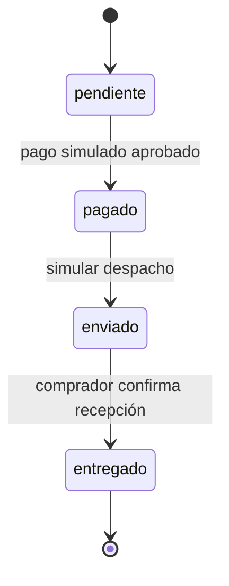

# Patrones en el flujo real

Implementación: `Pagina Web/backend/academic/patterns.py`.
Integración: `commerce.py:quote_cart`, `checkout` y `advance`.

## Builder

`OrderBuilder` reúne variantes, cantidades, cupón y envío. Agrupa variantes
repetidas y devuelve un `OrderDraft` inmutable. La tarifa usa la cantidad final,
aunque se configure la estrategia antes de agregar los ítems.

```python
draft = (OrderBuilder()
    .add_item(101, 2, '25.00')
    .add_item(102, 1, '25.00')
    .with_coupon('GRUPO', 10)
    .shipping(StandardShipping(), '12.00', 'Lima')
    .build())
```

Subtotal S/75,00; volumen S/2,25; cupón S/7,28; envío S/12,00;
total **S/77,47**. Dinero con `Decimal` y redondeo de mitad hacia arriba a dos
decimales en cada paso.

## Strategy

`ShippingStrategy.calculate` tiene tres implementaciones intercambiables.
El courier determina la estrategia y el distrito el departamento.
Son tarifas educativas sobre `couriers.costo_base`.

| Estrategia | Lima | Otros departamentos |
| --- | --- | --- |
| Estándar | base | base × 1,35 |
| Rápido | base × 1,40 + S/0,50 por unidad | base × 1,75 + S/0,50 por unidad |
| Económico | base × 0,85 | base × 1,15 |

Plazos simulados: 5, 2 y 7 días respectivamente. Los ocho couriers se distribuyen
entre las tres estrategias al importar. El procedimiento MySQL repite estas
reglas para verificar el total antes de confirmar.

## Decorator

`BasePrice` implementa `PriceComponent`; `PercentageDiscount` envuelve otro
componente y conserva su desglose. La cotización aplica 3% por tres unidades o
más y luego el cupón vigente, sobre el importe restante. El envío se suma después.

```python
price = PercentageDiscount(
    PercentageDiscount(BasePrice(Decimal('100')), Decimal('3'), 'Volumen'),
    Decimal('10'), 'Cupón')
assert price.total() == Decimal('87.30')
```

## State

`OrderContext` conserva un `OrderState` y delega transiciones en los estados
concretos: `PendingState.pay`, `PaidState.ship` y `ShippedState.deliver`.
Las operaciones no permitidas lanzan un error. Entregado y cancelado son terminales.



`checkout` valida pendiente→pagado con State. MySQL confirma el cambio junto con
stock y pago. `advance` bloquea el pedido, valida con State y actualiza la fecha
del envío en la misma transacción. Solo el comprador confirma recepción.
Repetir el estado actual es idempotente; saltar pagado→entregado devuelve conflicto.

## Transacción

El Builder produce una cotización. `confirmar_pedido` verifica de nuevo precio,
cupón, destino, tarifa y total esperado; normaliza ítems con `JSON_TABLE` y
descuenta stock condicionalmente bajo bloqueos InnoDB. Si falla una variante,
revierte todo. La clave `(id_usuario, solicitud_uuid)` y el hash del contenido
evitan duplicar una solicitud. Las pruebas reales cubren concurrencia para la
última unidad y rollback de pedidos multítem.


## Repository: acceso a datos con clases

`academic/repositories.py` define CatalogRepository y OrderRepository.
La cotización obtiene variantes, cupón, courier y distrito mediante el primero;
el segundo consulta recibos en lote, comprueba acceso, lista compras/ventas,
bloquea y actualiza estados y llama al procedimiento transaccional.
`commerce.py` usa ambas clases; no son ejemplos desconectados de la aplicación.

Las conexiones se inyectan por constructor. El Repository de pedidos encapsula
la llamada al procedimiento en una conexión con transacción propia; los errores
se propagan y el servicio decide su respuesta HTTP. Los valores se pasan como
parámetros. Las decisiones de precio y estado pertenecen al dominio, no al SQL
de presentación. Esto separa persistencia, reglas comerciales y rutas HTTP.

Así se justifican cinco patrones en la entrega: Builder, Strategy, Decorator,
State y Repository. Las compras y las pruebas de integración usan esta capa.
