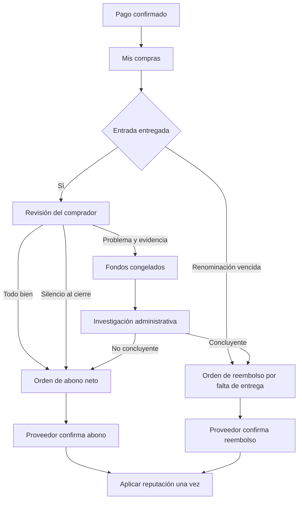

# Flujo postcompra implementado

5 de noviembre de 2026. Trabajo revisado con Bobby. Implementación local, sin aplicar migraciones a la base real ni ejecutar movimientos financieros reales.

## Comportamiento

La compra confirmada aparece en **Mis compras**, con descarga privada de la entrada. Si requiere renominación, la entrega queda pendiente hasta recibir el archivo nuevo. Desde la entrega se habilitan conformidad o reclamo. El plazo se guarda al comprar: **finalización del evento +24 horas**. Las nuevas publicaciones exigen fecha de inicio y finalización explícitas con zona horaria.

| Resultado | Orden financiera | Comprador | Vendedor |
|---|---|---|---|
| Confirma que todo está bien | Abono neto al vendedor | +0,25 | +0,25 |
| No responde al vencer el plazo | Abono neto al vendedor | Sin cambio | +0,25 |
| Reclamo con evidencia concluyente | Reembolso íntegro al comprador | +0,25 | Advertencia; rating sin cambio |
| Reclamo con evidencia no concluyente | Abono neto al vendedor | −0,25 | +0,25 |

Rating inicial **4**, acotado entre **0 y 5**. La reputación se aplica después de confirmar el resultado financiero, exactamente una vez. Los vendedores con mayor rating aparecen primero, incluso durante búsquedas; una promoción no cambia esa prioridad. El comprador paga únicamente el precio publicado. Comisión del 10 % y cargos externos se descuentan al vendedor.

Confirmar antes del concierto es posible por instrucción del usuario. Un diálogo explica que la decisión autoriza el abono y cierra el reclamo ordinario. Un reclamo presentado a tiempo mantiene el dinero congelado aunque venza el plazo. Administración descarga la evidencia privada y registra resolución y motivo. Una decisión final no puede reemplazarse por otra contradictoria.

## Persistencia y recuperación

- La decisión y el intento financiero se guardan antes de llamar al proveedor. Un segundo trabajador no vuelve a emitir la misma orden.
- Una operación incierta queda en conciliación. No se reenvía para comprobar si funcionó. Los reembolsos inciertos se consultan contra el cargo autenticado; las transferencias requieren conciliación con el proveedor contratado.
- Un proveedor ausente, un rechazo o cargos del vendedor sin conciliar conservan la operación pendiente y visible en administración. No producen puntos ni una confirmación ficticia.
- La renominación incumplida crea una orden auditable de reembolso; no deja los fondos fuera de la cola administrativa. Un reembolso pendiente heredado exige conciliación antes de reenviar.
- Las compras antiguas liberadas o reembolsadas siguen visibles. La migración no repite pagos ni aplica reputación retroactiva; la interfaz distingue esos registros históricos de una confirmación bancaria nueva.
- Sin finalización conocida, una compra antigua no vence automáticamente. El comprador puede confirmar o reclamar desde la entrega. Una fecha extrema no rompe la aplicación después de cobrar: se valida antes de publicar y cobrar y el calendario heredado tiene un tratamiento seguro.
- Evidencia cifrada PNG/JPG, máximo 5 MB y dimensiones limitadas. Solo comprador correspondiente y administración tienen acceso. El vendedor y otros compradores no pueden descargarla.

## Evidencia de validación

La ejecución ampliada y sus recuentos se registran en [el informe de producción](INFORME_PRODUCCION.md). Incluye backend con PostgreSQL temporal, navegador Chromium, pruebas del gateway, TypeScript/ESLint, compilación, dependencias y análisis estático. Los flujos financieros se ejecutan con adaptadores de prueba; no certifican movimientos reales.

Resultado final: **118 pruebas aprobadas, sin omisiones**: 82 backend (incluidas 8 PostgreSQL), 30 navegador Chromium y 6 gateway. Compilación y lint aprobados. Auditorías npm/Python sin vulnerabilidades conocidas; Bandit sin hallazgos altos ni medios. Firefox y contenedores conservan las limitaciones documentadas en el informe general.

Se verifican las cuatro ramas de la tabla, límites de rating, privacidad y obligatoriedad de evidencia, recuperación de una caída al subirla, doble confirmación, decisiones administrativas contradictorias, vencimiento exacto, datos antiguos, renominación incumplida, resultado financiero incierto, conciliación sin duplicados y carreras de PostgreSQL. Las migraciones se ejecutan dos veces sobre un esquema temporal y también se comprueba la creación desde tablas sin las nuevas columnas ni tablas de revisión.

En navegador se recorren compra, buzón, QR, confirmación, silencio al cierre, reclamos aceptados y rechazados, descarga administrativa de evidencia y actualización de rating tras un recibo sintético. Los formularios de reclamo y administración se revisan con axe en móvil/oscuro y escritorio/claro. Se conservan las pruebas previas de acceso, publicación, pagos rechazados, timeouts, sesiones, errores de red y accesibilidad general.

## Pendiente para operar con dinero real

El abono bancario al vendedor **todavía no está integrado**. Se mantiene explícitamente bloqueado, con `SETTLEMENT_ENABLED=false` como configuración de ejemplo. El código Culqi de reembolsos requiere certificación en sandbox; la respuesta de un test no demuestra que el banco haya devuelto fondos.

Faltan proveedor y contrato compatibles, onboarding del vendedor, cuenta bancaria verificada, conciliación de tarifas, pruebas externas de cobro/3DS, desembolso y devolución, configuración real y despliegue. La recomendación y sus fuentes están en [Opciones de pagos en Perú](OPCIONES_PAGOS_PERU.md). El procedimiento de migración, configuración y recuperación está en [DEPLOY.md](../../DEPLOY.md).
